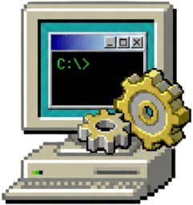

# BashMenuGenerator


**BashMenuGenerator (BMG)** is a lightweight, powerful utility for creating, editing and compiling bash menu scripts on Linux. What started as a simple question-and-answer wizard has evolved into a complete terminal workbench featuring interactive arrow-key menus, nested submenus, a built-in text editor, persistent settings, native file browsers and an integrated binary compiler.

Create everything from simple command launchers to complex, multi-level menu systems with custom commands, root privileges and password protection.

> 🪟 **Looking for Windows support?** Check out the original Windows version, [BatchMenuGenerator](https://github.com/Viknikux/BatchMenuGenerator), which creates `.bat` menus and `.exe` files!

---

## 🚀 Quick Start

### Option 1: Download a prebuilt binary

Grab the file that matches your system from the [latest release](https://github.com/Viknikux/BashMenuGenerator/releases/latest). The binaries are fully static, so there is nothing to install first.

| Your system | Download |
|---|---|
| 64-bit Linux | **`BashMenuGenerator`** (x64) |
| 32-bit Linux | **`BashMenuGenerator_x86`** |

```bash
chmod +x BashMenuGenerator
./BashMenuGenerator
```

Want to verify the download? Put it next to the release's `SHA256SUMS` file and run `sha256sum -c SHA256SUMS --ignore-missing`.

> ⚠️ A 32-bit system cannot run the x64 binary. A 64-bit system can run the x86 binary only if it has 32-bit support, so on 64-bit Linux simply use the x64 build.

### Option 2: Build from source

BashMenuGenerator is a single C++ source file with no library dependencies, so building it takes one command. This is also the way to get it on other CPU architectures, such as ARM.

```bash
git clone https://github.com/Viknikux/BashMenuGenerator.git
cd BashMenuGenerator
bash build.sh
./BashMenuGenerator
```

`build.sh` produces a stripped binary for your machine, fully static whenever the static libraries are installed (see [Required packages](#required-packages)).

| Command | Result |
|---|---|
| `bash build.sh` | Builds `BashMenuGenerator` for your machine. On 64-bit x86 it also builds `BashMenuGenerator_x86` when a 32-bit toolchain is installed. |
| `bash build.sh x64` | 64-bit build only. |
| `bash build.sh x86` | 32-bit build only. Needs a 32-bit toolchain, for example `g++-multilib` on Debian and Ubuntu. |
| `bash build.sh release` | Both builds plus a `SHA256SUMS` file |
| `bash build.sh clean` | Removes everything the script built. |

You can also compile it by hand: `g++ -std=c++14 -O2 -o BashMenuGenerator BashMenuGenerator.cpp`

On the first launch an optional setup offers to install the `bmg` command and desktop launchers. You can run it again at any time under **Settings → Set Up Program**.

---

## ✨ Features

### 🖥️ Interactive Menu System

- **Arrow-Key Interface (TUI):** Navigate menus using Up/Down, Enter and Esc instead of constantly typing numbers or answering Y/N prompts, Home/End and PageUp/PageDown work too, tall menus scroll to fit your terminal, and resizing the window is handled live.
- **Nested Submenus:** Create hierarchical menu systems up to 6 levels deep, with up to 20 options per menu.
- **Custom Menu Appearance:** Choose between Classic (`=`), Modern (`-`), Zigzag (`Z`) and Custom character borders, including Unicode characters such as `═`.
- **Built-in Theme Engine:** Customize the entire interface with different color presets, including Default, Matrix, Cyberpunk, CLI and Violent. The default text color follows your terminal, so light and dark terminals both look right, and `NO_COLOR` is respected.
- **Optional Menu Sounds:** Enable subtle navigation and confirmation sounds through SoX, `canberra-gtk-play` or `paplay`, or the plain terminal bell.
- **Classic Prompt Mode:** Prefer the traditional keyboard input experience? Disable TUI Mode in Settings. Classic prompts are also used automatically when input is piped or `TERM=dumb`.

### ⚙️ Powerful Script Generation

- **Multiple Run Modes:** Execute commands directly in the menu's own shell (so `cd` and variables carry over), through an isolated `bash -c` wrapper, or open a nested submenu.
- **Command Chaining:** Assign multiple commands to individual menu options. Commands are written to the script exactly as typed, so multi-line constructs such as functions work. Use commands such as `sleep` to introduce execution delays.
- **Root Privileges:** Automatically relaunch with `sudo` (or `doas`) when required.
- **Password Protection:** Add password verification to generated menus. The password is stored only as a salted SHA-256 hash, never as plain text.
- **Custom Titles & Descriptions:** Create personalized menu headers, descriptions and even ASCII-art banners.
- **Safe Quoting:** Titles, labels and descriptions are single-quoted, so `$`, backticks, quotes and other special characters are printed literally and can never break the generated script or run code.
- **Ctrl+C Done Right:** Interrupting a running option stops just that option and returns you to the menu.
- **Plain, Readable Bash:** The output is an ordinary bash script with one function per menu and per option, so you can read it and tweak it by hand.

### ✏️ Built-in Text Editor

A full-screen terminal text editor is integrated directly into BashMenuGenerator.

- Edit text configurations, command lists, descriptions and existing text files.
- Undo and redo with up to 200 history steps.
- Find text using `Ctrl + F` and repeat searches with `F3`.
- Select text using `Shift + Arrow Keys` or `Ctrl + A`.
- Copy, cut and paste using familiar keyboard shortcuts. The system clipboard is used when `wl-clipboard`, `xclip` or `xsel` is installed, and pasting through your terminal works as well.
- Navigate and delete entire words with Ctrl-based shortcuts.
- Save using `Ctrl + S`.
- Live status bar displaying line, column and selection information.

### 📄 Text Configuration Mode

Build complete menu systems using plain-text configuration files instead of answering wizard questions.

- Edit configurations directly inside the built-in editor or in your preferred text editor (`$VISUAL`, `$EDITOR`, nano, vim, Kate... selectable in Settings).
- Load existing `.txt` configurations.
- Supports UTF-8 (with or without BOM) and UTF-16 LE.
- Define menu options, commands, custom borders and nested submenus.
- Built-in, scrollable syntax tutorial with examples.
- **Same syntax as BatchMenuGenerator:** `admin`, `root` and `sudo` are interchangeable in both programs, and `save` accepts `.sh` / `.bat` and `.bin` / `.exe` file names. A configuration written on one system works on the other, only the commands themselves differ.

A small example:

```text
title Admin Toolbox
description Version 1.0
root y
option num: 2
option 1 label Disk usage
option 1 {
    df -h
}
option 2 label Tools
option 2 {
}
runmode 2
option 2 suboption 1 label Uptime
option 2 suboption 1 {
    uptime
}
save --toolbox.sh--~/Desktop
```

### 🔄 Edit Existing Scripts

Already generated a menu? You don't have to start over!

Open previously generated scripts and modify their contents directly.

- Edit titles, descriptions and passwords.
- Enable or disable root privileges.
- Change menu borders.
- Add, remove and reorganize menu options.
- Edit commands and run modes.
- Create and modify nested submenus.
- Compile the modified script directly into a binary.

**Compatibility:** Scripts generated by BashMenuGenerator 1.5.0 can be reopened in the Script Editor. They must retain the `# Created with BashMenuGenerator!` watermark near the top of the file to be recognized. Scripts from earlier builds use a different layout: they still run, but can't be reopened in the editor.

### 📦 Built-in Binary Compiler

Convert generated menus (or any script) into standalone executables without relying on external converters.

- Compile directly after generating a script.
- Compile from the Script Editor.
- Compile through Text Mode configuration (`save --name.bin--path`).
- Compile any script using the command line.
- Uses the C compiler it finds (for example `cc`, `gcc` or `clang`) to build a tiny launcher. If no compiler is installed, a built-in packer creates the binary instead, so there is nothing extra to install.
- The script runs from memory, so no readable copy is written to disk.
- Passes command-line arguments to the original script.
- Returns the original script's exit code.
- Honors the script's `#!` line (bash by default), so non-bash scripts compile too.

> ⚠️ **Security note:** The embedded script is scrambled using a randomly generated key for each build. This is basic obfuscation, NOT encryption. It should not be considered a secure way to protect passwords, credentials or other sensitive information.

### 💾 Settings & AutoSave

- **Persistent Settings:** Save your preferred configuration between launches.
- **Smart AutoSave:** Automatically preserve unfinished sessions and resume where you left off, even in the middle of an option. The AutoSave file is readable by you only.
- **End Action:** Choose what happens after saving a script: ask, return to the main menu, launch the script or exit.
- **Save/Load Preferences:** Automatically use a file browser dialog or manual path input.
- **Default Menu Borders:** Skip repeated border selection.
- **Theme Preferences:** Keep your preferred interface colors.
- **File Browser & Text Editor:** Choose which graphical file browser and which terminal editor the program uses.

Settings are stored in:

```text
~/.config/BashMenuGenerator/settings.txt
```

The configuration uses simple `key: value` lines and can be edited manually. Working files (AutoSave, the Text Mode scratch file and the copy installed by Program Setup) live in `~/.local/share/BashMenuGenerator`. Both locations honor `$XDG_CONFIG_HOME` and `$XDG_DATA_HOME`.

### 🗂️ Native File Browsers

Whenever the program needs to open or save a file, it can use your desktop's own dialog.

- **Auto-detect:** `zenity` (GNOME, Xfce, Cinnamon, MATE), `kdialog` (KDE Plasma), `qarma` (LXQt) or `yad`, chosen to match your desktop.
- **Your choice:** Pin a specific browser in **Settings → File Browser**.
- **Built-in terminal browser:** Over SSH or without a desktop session, a keyboard-driven browser takes over automatically: arrows to move, Enter to open, Backspace to go up, `/` to type a path (Tab completes it), `.` to show hidden files and Esc to cancel.

### 🛠️ Program Setup

BashMenuGenerator includes an optional first-time setup utility.

- Move the program into `~/.local/share/BashMenuGenerator`.
- Create a desktop shortcut.
- Add the program to the applications menu.
- Install, update or uninstall the `bmg` command.
- Automatically add `~/.local/bin` to your PATH when needed, without requiring root privileges. Uninstalling removes exactly what was added.
- **Native look:** The program icon is embedded in the program itself and installed into your icon theme (16 to 256 px) together with the launchers, so they look like any other desktop application.

### 💻 Command-Line Support

Control BashMenuGenerator directly from the terminal using its built-in command-line switches.

| Command | Description |
|---|---|
| `bmg -cli` | Open the built-in text editor immediately. |
| `bmg -config "file.txt"` | Load a configuration and generate its menu. |
| `bmg -edit "file"` | Edit a generated script or ordinary text file. |
| `bmg -compile "script.sh"` | Compile a script into a binary without opening the menus. |

You can use `--` instead of `-` for switches, for example `--config` or `--config=file.txt`. `bmg -h` shows the usage.

The compiler returns exit codes that can be used in other scripts:

- `0` – Compilation successful.
- `1` – Compilation failed.
- `2` – Invalid usage or file not found.

A configuration with a `save` line runs completely unattended, which makes `bmg -config` safe to call from other scripts. It returns `0` when the file was saved, `1` when saving failed and `2` when the configuration could not be used.

Once the `bmg` command is installed, you can launch the application from any terminal location.

---

## 🐧 Compatibility & System Requirements

<sub>No meaningful hardware requirements!</sub>

BashMenuGenerator runs on practically any Linux system. If your computer can run Linux and open a terminal, it should be capable of running BashMenuGenerator. The release binaries are fully static: they bring their own C library, so they need no packages and no particular distribution.

### At a glance

| | Requirement |
|---|---|
| **Operating system** | Linux |
| **Linux kernel** | **3.2 or newer** for the release binaries. With 3.17 or newer, compiled binaries run their script straight from memory. Older kernels use a private temporary file instead, so everything still works. |
| **CPU** | x64 build: any 64-bit x86 (x86-64) CPU. x86 build: Pentium Pro class (i686) or newer. |
| **Libraries and packages** | None for the release binaries. Nothing needs to be installed on the target system, not even glibc or libstdc++. |
| **Terminal** | A UTF-8 terminal emulator or SSH session that understands standard ANSI/xterm escape sequences. For `Shift + Arrow` selection in the editor it needs to send xterm-style modified arrow keys, which most do. |
| **Privileges** | None. Root is only used by menus you create with root privileges enabled. |

### Required packages

**To run BashMenuGenerator:** none.

**To run the menus it generates:**

| Needed | Why |
|---|---|
| `bash` | The generated scripts are bash scripts. |
| `id`, `sleep`, `cut`, `sed` | Root check, a short pause before relaunching, and password hashing. Part of coreutils and sed (BusyBox provides them too). |
| `sudo` or `doas` | Only for menus with root privileges enabled. |
| `sha256sum`, `shasum` or `openssl` | Only for password-protected menus. |

> Minimal systems and containers (Alpine, for example) often ship without `bash`. Install it first, for example with `apk add bash`.

**To build from source:**

| Needed | Notes |
|---|---|
| `g++` with C++14 support | Compiles cleanly with `-std=c++14` and `-std=c++17`. |
| C and C++ development files | Installed together with `g++` on most distributions. |
| Static libraries (`libc.a`, `libstdc++.a`) | For a fully static binary. Debian and Ubuntu include them. Fedora needs `glibc-static` and `libstdc++-static`. Without them `build.sh` falls back to a dynamic build and tells you. |
| 32-bit toolchain | Only for the x86 build on a 64-bit machine: `g++-multilib` on Debian and Ubuntu, `glibc-devel.i686` and `libstdc++-devel.i686` on Fedora. |

### About these numbers

- The minimum kernel is what the release binaries declare in their ELF header (`readelf -n BashMenuGenerator`), which comes from the C library they are linked with. `build.sh` prints it after every build.
- BashMenuGenerator is developed and tested on Ubuntu 24.04, 26.04 and Linux Mint Cinnamon 22.3. Generated scripts only use long-standing bash features, so older bash versions are expected to work, but they have not been tested.
- Anything not listed here, such as other CPU architectures or unusual terminals, is untested. Reports are welcome in the **Issues** tab.

### Optional extras

Everything below is detected at runtime and the program works without it.

| Feature | Uses |
|---|---|
| Graphical file browser | `zenity`, `kdialog`, `yad` or `qarma` |
| System clipboard in the built-in editor | `wl-clipboard` (Wayland), `xclip` or `xsel` (X11) |
| Compile to binary (tiny launcher) | a C compiler such as `cc`, `gcc` or `clang` (a built-in packer is used otherwise) |
| Root menus | `sudo` or `doas` |
| Password-protected menus | `sha256sum`, `shasum` or `openssl` |
| Menu sounds | SoX, `canberra-gtk-play` or `paplay` (the terminal bell otherwise) |
| Launcher trust on GNOME | `gio` |

---

## 📸 Preview

### The Main Menu with TUI mode enabled

```text
  ============================================
               BashMenuGenerator
  ============================================

     > Make new Bash Menu
        Text Mode
        Edit existing generated .sh script
        Settings (bconfig)
        Exit Program
```

### The Settings menu

```text
  ============================================
               SETTINGS (bconfig)
  ============================================

     > Theme Engine : 0 [Disabled]
        AutoSave     : 1 [Enabled]
        TUI Mode     : 1 [Enabled]
        Menu Sounds  : 0 [Disabled]
        End Action   : 0 [Prompt]
        Saveload     : 0 [Prompt]
        Menuborder   : 0 [Prompt]
        File Browser : auto [zenity]
        Text Editor  : auto [nano]
        Set Up Program
        [ Save & Exit ]
        [ Cancel ]
```

### A generated menu

```text
=========================================================
                      Admin Toolbox
=========================================================

 Version 1.0
 Pick an option and press Enter

=========================================================

 1) Disk usage
 2) System tools
 3) Who is logged in
 X) Exit

=========================================================

Select Option (1-3):
```

---

## 🔄 What's New in 1.5.0?

Version 1.5.0 is a ground-up rewrite that brings BashMenuGenerator to feature parity with BatchMenuGenerator 1.5.0.

### Major Additions

1. Nested submenu support (up to 6 levels).
2. Interactive arrow-key navigation throughout the application.
3. Persistent settings and customizable TUI themes.
4. Built-in script-to-binary compiler.
5. Ability to reopen and edit previously generated scripts.
6. Full-screen built-in terminal text editor.
7. Text Mode with the same configuration syntax as BatchMenuGenerator.
8. New command-line switches for automation.
9. First-time setup utility, desktop launchers with an embedded icon and automatic `bmg` command installation.
10. Native file browsers (GNOME, KDE, Xfce and more) with a built-in terminal fallback.

### Additional Improvements

- Safe single-quote escaping of every title, label and description line.
- Passwords stored as salted SHA-256 hashes instead of plain text.
- Ctrl+C stops only the running option.
- Commands written to the script exactly as typed, so functions and here-documents work.
- Case-insensitive menu choices.
- Live title preview.
- Preserved indentation in descriptions and ASCII-art banners.
- Improved save-conflict handling.
- Better AutoSave and session recovery.
- The terminal is always restored cleanly, even after Ctrl+C or when the process is terminated.

### Compatibility with BatchMenuGenerator

Both programs are built to work side by side.

- Text configurations use the same syntax. `admin`, `root` and `sudo` mean the same thing in both, and `.sh` / `.bat` and `.bin` / `.exe` save names are accepted by both.
- Run Modes 0 (Direct) and 1 (wrapper) and Run Mode 2 (Submenu) are numbered identically.
- Settings files found next to the program from earlier builds are migrated automatically.

---

## 🤝 Contributing & Bug Reports

Found a bug, encountered an issue or have an idea for a new feature?

Feel free to submit a report or suggestion through the repository's **Issues** tab.

Pull requests, improvements and feature suggestions are always welcome!

If you find BashMenuGenerator useful, please consider giving the repository a **Star ⭐**. It helps support development and makes the project more visible to other users.

---

<p align="center">
  <b>BashMenuGenerator</b><br>
  Making Linux shell easier
</p>
